# User guide

The Outside Inside turns the M-VAVE FM-1 into a window onto somewhere else: an endless stereo field recording of fifteen
places, from city streets and a summer meadow to the Arctic ice and an alien plain, made entirely by synthesis. Nothing
is a sample and nothing loops, so it never quite repeats. You choose where you are and what the day is like; the place
does the rest. This guide starts with a quick reference and the first five minutes, then works out to the details.

## Contents

1. Quick reference
2. Installing
3. The first five minutes
4. The screen
5. The four layers
6. The macros: weather, time, activity, entropy
7. The places
8. The weather
9. Mixing your own environments
10. Journey
11. Dream
12. GLOBAL and USB audio
13. MIDI
14. The screen reader
15. Ideas to try
16. When something's not right
17. Making music with it

---

## 1. Quick reference

| Control | What it does |
|---|---|
| K1 to K4 | the four layers' volumes: WEATHER, ANIMALS, LANDSCAPE, HUMANS |
| HOME held + K1 to K4 | the macros: WEATHER, TIME, ACTIVITY, ENTROPY |
| SEL held + K1 to K4 | each layer's density: how often its events happen |
| HOME tapped | the FM-1's health: processor load, cores, saving, and what each layer costs |
| ALGORITHM knob | the environment: JOURNEY, DREAM, the fifteen places A to Z, then your own |
| SEL tapped, or SELECT knob | choose the layer to edit (its preset list opens) |
| PRESET knob | the chosen layer's preset: any place's sound for that layer |
| REC | randomise the macros |
| SAVE | keep the scene as your own environment (up to 8) |
| PLAY | stop and start (it fades) |
| OCT- / OCT+ | the previous or next weather; on a journey or a dream, hold here or travel on now |
| first four white keys | one event now from WEATHER, ANIMALS, LANDSCAPE, HUMANS |
| GLO | the GLOBAL menu: USB AUDIO |

Only the buttons and keys that do something light up. They glow, and light fully while pressed. PLAY is green while
it plays, SAVE lights while there's something unsaved, and GLO while its menu is open.

## 2. Installing

You need a computer with **Chrome or Edge** and a USB cable for the FM-1.

1. Open the [installer](../install/) and plug in the FM-1.
2. Follow the page. It takes about a minute, and the FM-1 restarts into The Outside Inside.

It works on FM-1s with either flash chip: the original Puya P25Q80 and the UC25HQ80 in units sold since autumn 2026.

The Outside Inside is unofficial and not affiliated with M-VAVE: you install it at your own risk. The same installer
can put M-VAVE's own firmware back at any time, and you can go back to any earlier version of The Outside Inside from
the [releases](https://github.com/TheGrizard/The-Outside-Inside/releases). Want to hear it first?
[Play it in your browser](../emu/).

## 3. The first five minutes

1. **Listen.** It starts in the FOREST, playing straight away.
2. **Turn K1 to K4** to set the four layers' volumes: WEATHER, ANIMALS, LANDSCAPE and HUMANS. Columns rise up from
   the bottom of the screen while you turn.
3. **Turn ALGORITHM** to go somewhere else. A list opens; stop on a place and you're there.
4. **Hold HOME and turn K1 to K4** to change the day: WEATHER, TIME, ACTIVITY and ENTROPY.
5. **Press OCT+ or OCT-** to step through the weathers, or **REC** for a random weather, time and mood.
6. **Press the first four white keys** to make something happen now: a gust, a bird, a splash, a passing car.
7. **Turn ALGORITHM all the way left to JOURNEY** and leave it: it travels round the Earth's places by itself,
   an hour a loop.

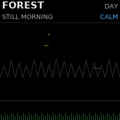

## 4. The screen

The top two lines say where you are and what it's like:

- **Top left:** the environment (FOREST). A star after it (`FOREST*`) means you've changed one of its layers' presets.
  On a journey or a dream it says JOURNEY or DREAM, in its own colour.
- **Top right:** the time of day: DAWN, DAY, DUSK or NIGHT (STOPPED when it's stopped).
- **Second line, left:** the place's mood (STILL MORNING, BUSY CHORUS, PASSING SHOWER...). On a journey: the place, and
  `> NEXT` while it's on the way. On a dream: where the land, the life and the people come from.
- **Second line, right:** the weather, in the weather layer's blue.

Below is the scene. Every sound you hear draws itself: birds in the sky, raindrops, ripples, a car crossing, a sheep
when one bleats. **Where something appears on the screen is where you hear it** in the stereo field: left to right,
and the further up, the further away. The backdrop is the place itself (a skyline, a treeline, dunes, an ice shelf, a
church), and fog, snow and storms tint the sky.

When you turn a knob or press a button, a panel shows what changed and fades away.

**Tap HOME** for how the FM-1 is doing:

- **CPU**: how busy its processor is.
- **2 CORES** or **1 CORE**: the FM-1 has two; the second renders two of the layers. If it ever fails to start, everything
  carries on on one.
- **SAVING OK**, or **NO SAVING** if the FM-1's flash chip is one the storage doesn't know (then settings last until
  power off).
- The last line: what each layer costs (W A L H, and M for the mix), in % of the time it has. A **G** number means it's
  thinning out events to keep up (see 16).

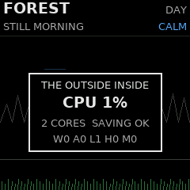

## 5. The four layers

Every environment is four layers of sound, each with its own colour, its own volume knob and its own events:

| Layer | Colour | What's in it |
|---|---|---|
| **WEATHER** | blue | wind, rain, snow, thunder: the air itself |
| **ANIMALS** | yellow | birds, insects, frogs, whales, sheep, the things that live there |
| **LANDSCAPE** | green | the place: water, leaves, ice, stone, machines' buildings, and the room it's all heard in |
| **HUMANS** | pink | people and their things: traffic, boats, bells, a lawnmower, a research station |

**K1 to K4** set their volumes, left to right as the columns show. Each column's bar shows the sound's level as it
plays, the white mark the volume you set.

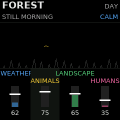

**Hold SEL and turn K1 to K4** to set each layer's **density**: how often its events happen, from almost never to
busy. 50 is as the place was designed.

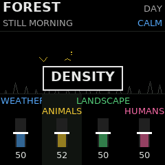

**The first four white keys** each make one event happen now in their layer, wherever you are: handy for a cue in a
set, or just to hear what lives there.

## 6. The macros: weather, time, activity, entropy

Hold **HOME** and turn the knobs:

- **K1, WEATHER** picks the weather type from the place's own list (see 8). OCT- and OCT+ step through the same list
  one at a time.
- **K2, TIME** is the time of day: DAWN, DAY, DUSK, NIGHT. Different animals and people come out at each: a dawn chorus,
  the morning rush, frogs and owls at night.
- **K3, ACTIVITY** is how much animal and human life there is.
- **K4, ENTROPY** is how much the scene changes by itself. At the bottom (FIXED) it stays as you set it. Turned up,
  the weather drifts towards the types either side of it, calmer or wilder, the light changes, and the place moves
  through its moods (a forest's still morning, its busy chorus, a passing shower).

**REC** throws the four macros at random: a new weather, time, activity and entropy in the same place. The panel
says what it picked.

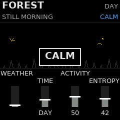

## 7. The places

Turn **ALGORITHM** for the list: JOURNEY and DREAM first, then the fifteen places A to Z, then your own (USER 1...).

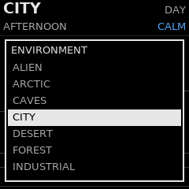

| Place | What you hear | Its moods |
|---|---|---|
| **ALIEN** | a singing wind and ion crackle, a spore chorus and growls, glass spires, geysers and pods, visiting craft and beacons | twin dawn, spore bloom, ion storm, long night |
| **ARCTIC** | a polar wind and spindrift, the ice cracking and groaning, bearded seals trilling under it, wolves and terns, a research station, its flag, a snowmobile | still cold, blizzard, midnight sun, ice on the move |
| **CAVES** | far, muffled airflow, bats and cave crickets, drips, an underground river, falling stone, a deep rumble and distant knocks | still, dripping, flooding, breathing |
| **CITY** | street wind and rain on roofs, sparrows and pigeons, gutters and street trees, the traffic's roar, passing cars, distant engines | afternoon, 3 AM, morning rush, rain |
| **DESERT** | mostly stillness: a dry wind carrying sand, booming dunes, stones ticking in the heat, a lark now and then, a scops owl, jackals, a caravan's bells, a 4x4 | midday heat, desert night, sandstorm, still dawn |
| **FOREST** | a breeze and rain on leaves, songbirds and an owl, a brook and the leaves rustling, a far road and aircraft | still morning, busy chorus, passing shower, breezy |
| **INDUSTRIAL** | pipe wind and rain on metal, pigeons and crows, girders, chains and dripping pipes, a motor hall, a stamping press, a forklift reversing, freight trains | full production, night shift, rain on the roof, locked up |
| **JUNGLE** | humid air and rain on leaves, tropical birds, cicadas, howler monkeys and tree frogs, the canopy dripping into a stream, a river boat and far voices | midday heat, morning chorus, downpour, night frogs |
| **MEADOW** | a summer breeze and rain on grass, skylarks, songbirds and a wood pigeon, bees flying by, grasshoppers, sheep over the hedge, a light aircraft, a far lorry | summer afternoon, busy day, passing shower, hazy heat |
| **MOUNTAIN** | a ridge wind, a buzzard, ravens and choughs, marmots, a far waterfall and rockfalls, cowbells and a church tolling in the valley below, a helicopter | clear day, cloud rolling in, still dawn, storm on the peaks |
| **OCEAN** | sea wind and squalls, gulls and whale song, the surf and the shingle, a buoy bell, rigging, a ship's horn | calm, choppy, storm, night tide |
| **SAVANNA** | a storm wind over the long grass, a lion's roars and grunts, hyenas, hornbills, doves and weavers, a camp's fire and generator, a jeep | dry noon, golden evening, storm season, night plains |
| **SPACE** | solar wind and static, unknown signals and a pulsar, the hull creaking and ticking, coolant, telemetry and comms | drift, systems busy, solar storm, deep sleep |
| **SWAMP** | humid air and rain on water, frogs, crickets and a heron, marsh gas bubbling, the reeds, an airboat | still noon, dusk chorus, rain, night |
| **VILLAGE** | rain on roofs, big trees and the pond, rooks, garden birds, ducks, a cockerel, cows and a dog, the church's bells ringing changes or tolling, a far church too, a lawnmower, the village road | Sunday morning, quiet afternoon, wet day, market day |

Some of the sounds were matched by ear to real recordings: the sheep, the city's traffic, the industrial machines,
the Arctic's seals, the savanna's lion, the desert's stillness and the village's church bells.

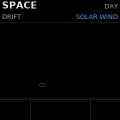
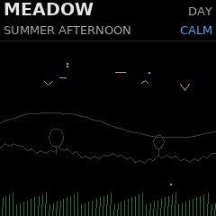
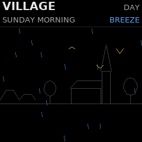

## 8. The weather

Each world has its own weather, and ENTROPY only ever drifts through that world's:

| World | Its weathers, A to Z |
|---|---|
| **Earth** (City, Caves, Forest, Industrial, Jungle, Meadow, Mountain, Ocean, Swamp, Village) | breeze, calm, downpour, drizzle, fog, gale, rain, snow, thunder (dry, with the odd light shower), thunderstorm, windy |
| **Space** | ice dust, magnetic storm, particle rain, solar flare, solar wind, still void |
| **Alien** | crystal fog, howling gale, ion drizzle, ion rain, ion storm, singing wind, still air |
| **Arctic** (it never rains) | blizzard, diamond dust, gale, ice fog, light snow, snow, still cold, windy |
| **Desert** (no rain, no snow) | breeze, dry thunder, heat haze, sandstorm, still air, windy |
| **Savanna** (no snow) | breeze, calm, downpour, heat haze, morning mist, rain, thunder, thunderstorm, windy |

The meadow starts calm, the Arctic in light snow, the desert in a heat haze, the savanna in a breeze.

- **Animals take cover.** In heavy rain, a storm or a gale the animals go quiet, and come back as it passes. Not in the
  jungle, which sings on: frogs love the rain.
- **Space and the alien world wander.** Their weather also drifts slowly by itself as ENTROPY rises, over minutes.
- **The sky shows it.** Fog and snow grey the sky, lightning flashes it, and the rain and snow fall across the scene.

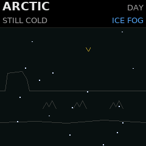
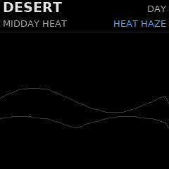

## 9. Mixing your own environments

Each layer's sound is a preset, and every place's layers are presets you can mix: the city's traffic in the forest,
whale song in a cave, sheep on the ice.

1. **Choose a layer.** Tap **SEL** (or turn **SELECT**). Its preset list opens in the layer's colour.
2. **Turn PRESET** to change that layer's preset, A to Z. The name gets a star (`FOREST*`).
3. **Set the levels, densities and macros** as you like.
4. **Press SAVE.** It's kept as USER 1, USER 2 and so on (up to 8), at the end of the ALGORITHM list. SAVE on one of
   your own environments saves over it; with all eight full, SAVE goes into USER 8.

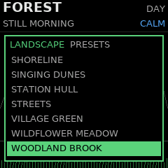

The LANDSCAPE layer is also the place: its room (the echo of a cave, the open air of a meadow), its backdrop on the
screen and its moods. Put a cave's landscape under a meadow's birds and the birds sing in the cave.

A built-in place starts with its own volumes and its densities as designed. Your own environments keep the volumes
and densities they were saved with.

**It remembers.** The scene you're in (levels, densities, macros, presets) is kept by itself a few seconds after your
last change, so the FM-1 comes back where you left it, playing. The SAVE light shows there's something you haven't
saved as your own.

## 10. Journey

JOURNEY (amber), first in the list, travels round the Earth's places on its own, about an hour a loop: forest, meadow,
city, industrial, ocean, swamp, jungle, caves and back to the forest. It was made to play under a live set.

- **The pace.** It stays six minutes in each place, then takes a minute and a half to get to the next.
- **The crossing.** On the way the weather turns first, then the other layers one at a time (the one loudest where
  you're going first, the one loudest where you were last), so for a while you hear both places at once, and the
  sound never drops out.
- **The weather** glides to one that suits the next place.
- **The day goes round.** A day lasts an hour, so one lap is one day: started at dawn, the forest is always morning and
  the caves always night.
- **Even loudness.** The places are evened out in level, so nothing jumps out of a mix.

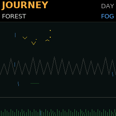

While it travels:

- **OCT+** travels on to the next place now. **OCT-** holds the journey where it is, and lets it go again.
- **K1 to K4** (or MIDI CC 20 to 23) set the mix of the four layers for the whole journey.
- Turning **WEATHER** takes the weather over until the next place. Turning **TIME** sets the time of day, and the day
  goes on from there. ACTIVITY and ENTROPY work as ever.
- **SAVE** keeps the place you're at as one of your own environments; the journey goes on.
- Switched off on a journey, the FM-1 comes back on a journey, from the place it was in.

## 11. Dream

DREAM (violet), second in the list, travels as the journey does (the same pace, the layers changing one at a time,
the day going round, OCT+ and OCT-, K1 to K4, SAVE), but each place is a mix drawn at random from all fifteen: the
land from one, and the animals, the people and the weather from it or from anywhere else. An alien plain fills with a
factory's machines; a cave fills with a meadow's birds.

The weather follows the weather layer's world: Space's and the alien world's are their own. The second line of the
screen says where the land, the life and the people are from (LAND/LIFE/PEOPLE). A mix is never heavier on the
processor than the heaviest place, and the loudness is held steady as the mixes change.

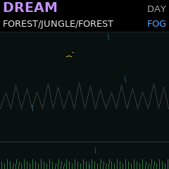

## 12. GLOBAL and USB audio

Plugged into a computer, the FM-1 shows up as a stereo audio input, so you can record The Outside Inside straight into
a DAW, or send it to a live set's mixer.

**GLO** opens the GLOBAL menu, settings for the FM-1 itself, kept over power off:

- **USB AUDIO** sets the level the computer gets.
  - **VOLUME KNOB** (the default): the same level as the speaker and headphones, so turning the FM-1's volume down
    turns the recording down too.
  - **FULL LEVEL**: the computer always gets the full level, and the volume knob only sets the speaker and headphones.
    Turn them down, or off, and the recording carries on at full level.

**Turn PRESET** (or ALGORITHM), or **tap SEL**, to change it. **GLO** or **HOME** closes the menu; any other control
closes it too, and then does its usual job.

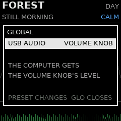

## 13. MIDI

Other gear (or a DAW) can move the knobs over USB MIDI, on any channel:

| CC | What it moves |
|---|---|
| 20 to 23 | the layer volumes: WEATHER, ANIMALS, LANDSCAPE, HUMANS (on a journey or a dream, its mix) |
| 24 to 27 | the macros: WEATHER, TIME, ACTIVITY, ENTROPY |

So a slow automation lane in your DAW can bring the weather in over a song, or pull the people out of a place.

## 14. The screen reader

The Outside Inside speaks: with the [FM-1 Screen Reader](https://github.com/charlesvestal/fm1-reader) open on the
computer the FM-1 is plugged into, it says what the screen shows as you change it (the place, the layer, the level,
the weather), and the whole screen when you ask.

## 15. Ideas to try

- **Rain on the window for sleep or study.** VILLAGE or CITY, WEATHER on rain, TIME at night, ACTIVITY down, ENTROPY
  low. Turn HUMANS down to nothing for a town that's gone to bed.
- **A live set's backdrop.** JOURNEY, with USB AUDIO on FULL LEVEL into your mixer. Set its mix with K1 to K4 once,
  then leave it. OCT+ moves on when the music does.
- **A storm rolling in.** FOREST or MEADOW, WEATHER on breeze, ENTROPY about halfway. Every so often turn WEATHER up a
  notch: drizzle, rain, thunderstorm. The birds take cover as it builds.
- **Somewhere that doesn't exist.** Start in CAVES, tap SEL to ANIMALS, and turn PRESET to SKYLARKS AND BEES. Or let
  DREAM do it for you.
- **An alien night.** ALIEN, TIME on night, ENTROPY up: the weather wanders by itself over minutes.
- **Cues by hand.** In a quiet place, play the first four white keys like a sampler: a gust, a call, a splash, a car.
- **A soundtrack.** Record a long take over USB, then cut it to picture: the time of day and the weather give it a
  shape.

## 16. When something's not right

- **No sound.** Check the layer volumes (K1 to K4) and the FM-1's volume, and that it's playing: the PLAY light is
  green. In a very still place (the desert, the Arctic in still cold) silence is part of it: press a white key to check.
- **I can't hear the animals.** Is it raining hard, or blowing a gale? They've taken cover. Turn WEATHER down, or wait
  for it to pass.
- **Something's too busy, or too rare.** Hold SEL and turn that layer's knob: its density.
- **Crackles or pops.** Tap HOME. If the costs add up near 100, or a G number shows, the FM-1 is near its limit and is
  thinning events out to keep up: try lower densities or less ACTIVITY.
- **It didn't remember my changes.** The scene is kept a few seconds after your last change: wait a moment before
  switching off. If HOME shows NO SAVING, the FM-1's flash chip isn't one the storage knows, and settings last until
  power off.
- **The recording is too quiet, or follows the knob.** Set GLOBAL's USB AUDIO to FULL LEVEL (see 12).
- **Going back.** The [installer](../install/) can put M-VAVE's firmware back, or any earlier version of The Outside
  Inside from the [releases](https://github.com/TheGrizard/The-Outside-Inside/releases).

## Safety

The Outside Inside is unofficial and not affiliated with M-VAVE. Installing any custom firmware is at your own risk.
The web installer can put M-VAVE's own firmware back at any time, and you can go back to any earlier version of The
Outside Inside from [Releases](https://github.com/TheGrizard/The-Outside-Inside/releases). If something sounds wrong,
tap HOME to see the load, and please [open an issue](https://github.com/TheGrizard/The-Outside-Inside/issues).

## 17. Making music with it, and supporting it

What you make with The Outside Inside is yours: release it, sell it, use it however you like. If you do release
something made with it, a credit ("made with The Outside Inside") is appreciated, though never required.

To support The Outside Inside, have a listen to my label, [Burnt Ends Records on Bandcamp](https://burntendsrecords.bandcamp.com/).
