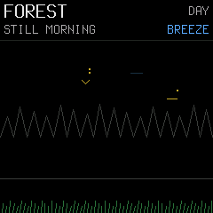

# The Outside Inside

Generative field recordings for the M-VAVE FM-1, made entirely by synthesis. Nine places to stand in, from city
streets to an alien plain; four layers of sound that never quite repeat; for playing along with, or leaving on in
the background.

**Version {{VERSION}}** (a test release) · **[Install it](install/)** · [Play it in your browser](emu/) ·
[Source](https://github.com/TheGrizard/The-Outside-Inside)

## Installing

Open the [installer](install/) in Chrome or Edge on a computer, plug the FM-1 in by USB and follow the page. It
installs over M-VAVE's own firmware or another FM-1 firmware, on FM-1s with either flash chip, and can put M-VAVE's
firmware back. You install it at your own risk. Or [download {{PKG}}](firmware/{{PKG}}) for the command-line
installer: `python3 tools/fm1_install.py {{PKG}}`.

## Playing

| Control | What it does |
|---|---|
| K1 to K4 | the volume of WEATHER, ANIMALS, LANDSCAPE, HUMANS (the levels rise up as you turn) |
| SEL held + K1 to K4 | each layer's density: how often its events happen |
| HOME held + K1 to K4 | the macros: WEATHER, TIME, ACTIVITY, ENTROPY |
| ALGORITHM | the environment: alien, caves, city, forest, industrial, jungle, ocean, space, swamp, then your own |
| SELECT, or tap SEL | the layer to edit; PRESET changes its preset |
| REC | randomise the macros |
| SAVE | save as your own environment (up to 8) |
| PLAY | stop and start |
| OCT- / OCT+ | the previous or next weather |
| the first four white keys | one event now from each layer |
| HOME tapped | the processor's load and whether settings are being saved |

ENTROPY is how much the scene changes by itself: at zero it stays as you set it; turned up, the weather drifts, the
light changes and the place moves through its moods. Where a sound appears on the screen is where you hear it.

The FM-1 also works as a USB audio interface: record it straight into a computer.

Made by [TheGrizard](https://github.com/TheGrizard) on [fm1-base](https://github.com/charlesvestal/fm1-base) and
felucca-bsp. Free software under the MPL-2.0.

M-VAVE and FM-1 are trademarks of their owners. The Outside Inside is not affiliated with M-VAVE.
